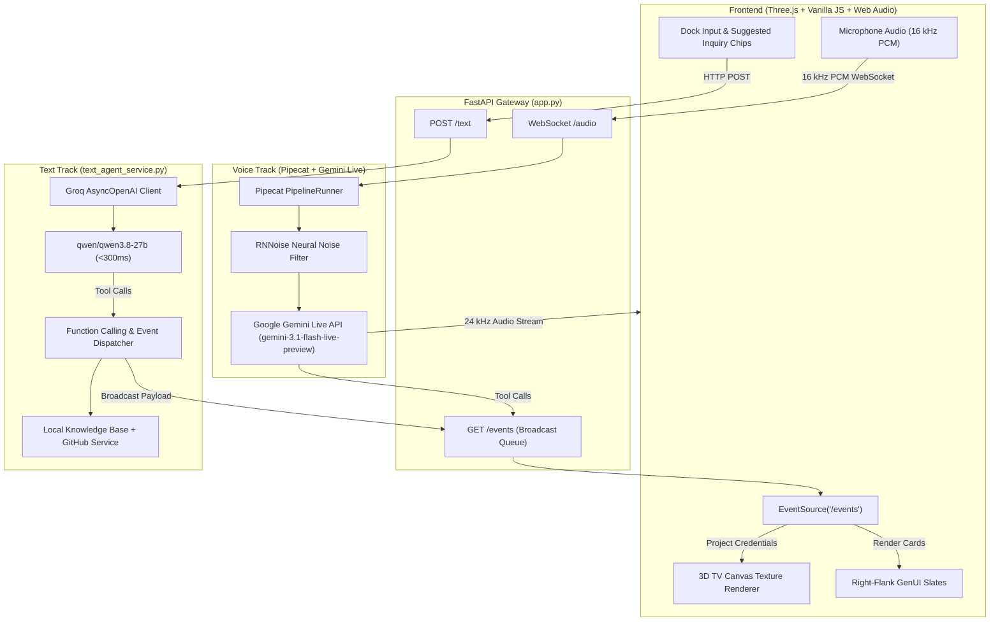

# Conversational 3D Agentic Portfolio | AI Digital Twin

<p align="center">
  
  
  
  
  
  
</p>

An interactive, multimodal 3D digital twin portfolio application combining real-time speech-to-speech voice interaction, high-speed secondary text inference, dynamic Generative UI (GenUI) slates, and procedural 3D canvas texture projections.

Rather than presenting a static document, this system acts as an autonomous digital twin capable of conversing via sub-second voice dialogue or typed text, dynamically rendering contextual project specimen cards, projecting verified credentials onto a 3D robot monitor, and streaming live GitHub activity.

---

## Visual Overview

### 1. Landing Screen & Audio Initialization
A minimalist editorial entry screen designed to initialize the browser's Web Audio context upon the first user interaction.

<p align="center">
  
</p>

---

### 2. Interactive 3D Stage & Spatial Avatar
The central stage features a 3D Titan TV Man model rendered in Three.js. The model's head display is driven by a dynamic HTML5 canvas texture that procedurally animates eye waveforms, status states, and credential projections during conversation.

<p align="center">
  
</p>

---

### 3. Dynamic Generative UI (GenUI) Slates
When users query projects, technical skills, or career history, backend function calls broadcast structured events over Server-Sent Events (`/events` SSE) to trigger slide-in GenUI slates alongside the 3D stage.

<p align="center">
  
</p>

---

## System Architecture

The application implements a **Dual-Track Multimodal Pipeline** that decouples real-time voice streaming from fast text queries:



---

## Core Technical Features

### 1. Dual-Track Hybrid Inference
* **Voice Track (Gemini Live & Pipecat):** Bi-directional 16 kHz raw PCM audio streaming over raw WebSockets. Built-in voice activity detection (VAD), interruption handling, and RNNoise neural noise suppression provide natural, sub-800ms conversational turnarounds.
* **Text Track (Groq `qwen/qwen3.8-27b`):** A dedicated, standalone text service ([text_agent_service.py](file:///d:/portfolio/portfolio_agentic/base_pipeline/backend/text_agent_service.py)) that handles all typed queries and prompt chips in under 300ms. Executes structured tool calling without consuming voice audio quotas or hitting rate limits.

### 2. Generative UI (GenUI) Event Orchestration
Backend function calls trigger live UI mutations without full page reloads:
* **Project Bento:** Renders interactive cards detailing project architectures, technologies, and GitHub repositories.
* **Technical Taxonomy Matrix:** Displays a 4-quadrant skill matrix with clickable exploration tags.
* **Career Chronology:** Renders an interactive milestone timeline.
* **Real-Time GitHub Activity:** Automatically queries the GitHub API to display recent commit messages, push dates, and open-source contributions (backed by a 5-minute in-memory cache).

### 3. Procedural 3D Canvas Screen Projection
* The 3D robot's face is an interactive 1024x1024 HTML5 Canvas mapped as a dynamic Three.js texture.
* Procedurally animates synthetic eye expressions and audio waveforms synchronized to voice states.
* On credential queries, dynamically projects high-resolution certificate badges directly onto the in-scene monitor screen.

### 4. Deterministic State Orchestration
* Governed by deterministic Finite State Machines (FSMs) for state transitions, tool dispatching, and session watchdogs, using LLMs strictly for semantic intent extraction and conversation.

---

## Tech Stack

| Layer | Technologies |
| :--- | :--- |
| **Backend & Routing** | Python 3.11, FastAPI, Pipecat AI, Uvicorn, AsyncIO, HTTPX |
| **Voice & Multimodal** | Google Gemini Live API (`gemini-3.1-flash-live-preview`), Raw PCM 16kHz/24kHz, RNNoise |
| **Secondary Text Agent** | Groq API (`qwen/qwen3.8-27b`), OpenAI Tool Schemas, Multi-Turn Context Memory |
| **3D & Spatial Graphics** | Three.js (r176), WebGL, GLTF Loader, HTML5 Canvas Texture Mapping |
| **Audio Processing** | Web Audio API, AudioWorklet (downsampling 48 kHz to 16 kHz), PCM Streaming |
| **Styling & Design** | Vanilla CSS, Space Grotesk, Inter, JetBrains Mono, Minimalist Tokens |
| **Integrations** | GitHub REST API (v3), SMTP Email & Resume PDF Dispatch |

---

## Repository Structure

```
portfolio_agentic/
├── base_pipeline/
│   ├── backend/
│   │   ├── app.py                 # FastAPI application, WebSocket transport, dual-track routing
│   │   ├── text_agent_service.py  # Standalone Groq text agent & tool execution service
│   │   ├── github_service.py      # Real-time GitHub commit tracker & cache
│   │   ├── session_manager.py     # Session persistence, idle watchdog, and context history
│   │   ├── PREADEEP.pdf           # Resume asset for automated email dispatch
│   │   └── data/                  # Knowledge base (clean structured JSON)
│   │       ├── about.json         # Portfolio technical identity & background
│   │       ├── projects.json      # In-depth project specifications
│   │       ├── skills.json        # 4-quadrant skill taxonomy
│   │       ├── experience.json    # Work timeline and career history
│   │       ├── certifications.json# Verified credentials and certificate image mappings
│   │       ├── achievements.json  # Hackathons, open-source PRs, and milestones
│   │       └── portfolio_faqs.json# Engineering FAQs
│   │
│   ├── frontend/
│   │   ├── index.html             # Single-page web application entry point
│   │   ├── css/
│   │   │   └── style.css          # Design tokens, GenUI slates, responsive dock & studio styling
│   │   ├── js/
│   │   │   ├── main.js            # UI state, query dispatcher, and SSE event handlers
│   │   │   ├── avatar.js          # Three.js 3D scene, lighting, and camera management
│   │   │   ├── tvScreenManager.js # 1024x1024 dynamic canvas renderer for the 3D monitor
│   │   │   ├── gemini-client.js   # Resilient WebSocket audio streaming client
│   │   │   ├── media-handler.js   # Microphone capture and speaker playback
│   │   │   └── pcm-processor.js   # AudioWorklet downsampler (48 kHz to 16 kHz PCM)
│   │   ├── assests/               # Certificate images and interface icons
│   │   └── model/                 # 3D robot GLTF model (`tv_man_titan.glb`)
│   │
│   └── requirements.txt           # Python backend dependencies
├── docs/
│   └── images/                    # UI screenshots for documentation
│       ├── 01_landing_entry.png
│       ├── 02_3d_stage_overview.png
│       └── 03_genui_featured_projects.png
└── README.md                      # Project documentation
```

---

## Local Setup & Installation

### 1. Prerequisites
* **Python 3.11+**
* **Google Gemini API Key** (for Gemini Live multimodal audio)
* **Groq API Key** (Free tier available at [console.groq.com](https://console.groq.com))
* *(Optional)* GitHub Personal Access Token (PAT) for extended GitHub REST API rate limits

### 2. Installation

Clone the repository and set up a virtual environment:

```bash
git clone https://github.com/Cyberpradeep/portfolio_agentic.git
cd portfolio_agentic

# Create virtual environment
python -m venv base_pipeline/venv

# Activate virtual environment
# Windows:
base_pipeline\venv\Scripts\activate
# Linux / macOS:
source base_pipeline/venv/bin/activate

# Install dependencies
pip install -r base_pipeline/requirements.txt
```

### 3. Environment Configuration

Create a `.env` file in `base_pipeline/`:

```env
# Gemini Live Voice Track
GEMINI_API_KEY=your_gemini_api_key_here
MODEL=gemini-3.1-flash-live-preview
VOICE_ID=Puck

# Groq Secondary Text Track
GROQ_API_KEY=your_groq_api_key_here
GROQ_MODEL=qwen/qwen3.8-27b

# Server Binding
HOST=127.0.0.1
PORT=8000

# Optional: GitHub API Token (boosts rate limit from 60 to 5,000 req/hr)
GITHUB_TOKEN=your_github_pat_here

# Optional: SMTP Email Dispatch Configuration
SENDER_EMAIL=your_email@gmail.com
SENDER_PASSWORD=your_email_app_password
```

### 4. Running Locally

Start the application:

```bash
cd base_pipeline/backend
python app.py
```

Open `http://localhost:8000` in a browser.

* **Voice Mode:** Click **"Engage Voice Twin"** to unlock the microphone and converse in real-time.
* **Text Mode:** Type queries into the input box or click any prompt spark chip. Groq resolves tool calls in sub-300ms and automatically opens the corresponding GenUI slates.

---

## License

Distributed under the MIT License.
