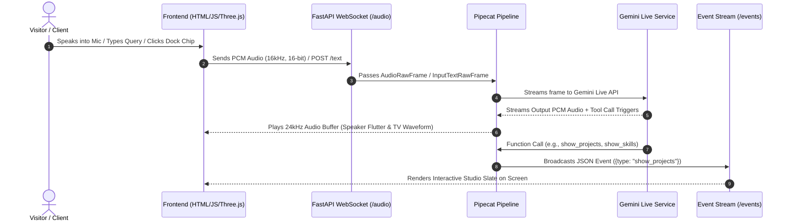

<div align="center">

  <h1>Pradeep Selladurai — 3D Digital Twin & Voice AI Portfolio</h1>
  <p><strong>A real-time, bi-directional speech & text conversational agent powered by FastAPI, Pipecat, Gemini Live, and Three.js 3D Titan rendering.</strong></p>

  <p>
    <a href="https://pradeepselladurai.me"></a>
    <a href="https://fastapi.tiangolo.com/"></a>
    <a href="https://github.com/pipecat-ai/pipecat"></a>
    <a href="https://threejs.org/"></a>
  </p>

</div>

---

## 📌 Overview

This project is an interactive 3D digital twin portfolio. Instead of a traditional static webpage or resume PDF, it hosts a conversational AI voice assistant that can answer questions about skills, projects, experience, and certifications while physically expressing states through a dynamic 3D Titan mecha avatar in real time.

### Key Capabilities

* **Speech-to-Speech & Text Interface:** Continuous 16kHz PCM audio streaming over WebSockets combined with typed query fallback and resilient auto-reconnection with exponential backoff.
* **3D Titan Mecha & Procedural Kinematics:** High-performance GLTF rendering (`tv_man_titan.glb`) featuring procedural breathing, cursor look-at inverse kinematics (IK), dynamic voice-synced chest and forearm acoustic speaker flutter, and cinematic studio directional lighting.
* **Dynamic 1024px Canvas TV Screen:** Procedural canvas texture featuring CRT raster scanlines, digital glitch effects, vector oscilloscope waveforms, idle matrix rain, and emotive face states rendered onto the 3D model's head display.
* **Generative UI (GenUI):** The LLM triggers structured tool calls that spawn interactive studio slates for engineered systems, project bentos, career chronology, and accredited certifications.
* **Dynamic Communication & Tools:** Built-in email dispatch (`SMTP`), PDF resume delivery, and instant deep-link routing for GitHub and LinkedIn.

---

## 🏗️ Architecture & Data Flow



---

## 🛠️ Tech Stack & Engineering Choices

### Backend
* **Python 3.11+ / FastAPI:** Async REST and WebSocket server handling audio transport, event streaming (`Server-Sent Events`), and static asset delivery.
* **Pipecat AI Framework:** Modular real-time pipeline runner orchestrating raw audio frames, serialization, and Voice Activity Detection (VAD).
* **Google Gemini Live API (`gemini-3.1-flash-live-preview`):** Native multimodal speech-to-speech engine delivering sub-second voice latency.
* **Uvicorn:** High-performance ASGI server for concurrent WebSocket and SSE connections.

### Frontend
* **Vanilla JavaScript & HTML5:** Zero-framework, lightweight JS client to maximize 60 FPS WebGL rendering performance.
* **Three.js (r176):** WebGL rendering engine with `MeshPhysicalMaterial` clearcoat glass shaders, anisotropic filtering, and studio shadow cascades.
* **TV Screen Manager:** Procedural 1024x1024 Canvas engine rendering multi-layer CRT scanlines, HUD telemetry, and voice reactive oscilloscope visuals.
* **Mechanical Kinematics:** Procedural bone rotations, damping spring algorithms, and voice volume-synced speaker membrane vibrations.
* **Web Audio API & AudioWorklet:** Custom PCM processor (`pcm-processor.js`) performing client-side downsampling from browser audio (48kHz) to 16kHz raw PCM.

---

## 💻 Local Development Setup

### 1. Prerequisites
* Python `3.11` or higher
* Google Gemini API Key

### 2. Installation

Clone the repository and set up a virtual environment:

```bash
git clone https://github.com/Cyberpradeep/portfolio_agentic.git
cd portfolio_agentic

# Create virtual environment
python -m venv base_pipeline/.venv

# Activate environment (Windows)
base_pipeline\.venv\Scripts\activate

# Activate environment (Linux/macOS)
source base_pipeline/.venv/bin/activate

# Install required packages
pip install -r base_pipeline/requirements.txt
```

### 3. Environment Configuration

Create a `.env` file in the project root or inside `base_pipeline/`:

```ini
GEMINI_API_KEY="AIzaSy..."
MODEL="gemini-3.1-flash-live-preview"
VOICE_ID="Puck"
SENDER_EMAIL="your_email@gmail.com"
SENDER_PASSWORD="your_app_password"
HOST="0.0.0.0"
PORT=8000
```

### 4. Running the Server

Start the backend server:

```bash
cd base_pipeline/backend
uvicorn app:app --host 0.0.0.0 --port 8000 --reload
```

Open your browser and navigate to `http://localhost:8000`.

---

## ☁️ Deployment Guide (Railway / Cloud)

This application is production-ready for deployment on **Railway**, **Render**, or **Docker containers**.

<details>
<summary><b>🚀 Click to expand Railway Deployment Instructions</b></summary>

<br />

1. **Procfile Verification:**
   Ensure `Procfile` exists at the root:
   ```
   web: cd base_pipeline/backend && uvicorn app:app --host 0.0.0.0 --port ${PORT:-8000}
   ```

2. **Environment Variables:**
   Add the following variables in your Railway Project Settings $\rightarrow$ **Variables**:
   * `GEMINI_API_KEY`: Your Gemini API key
   * `SENDER_EMAIL`: Email for sending contact form messages
   * `SENDER_PASSWORD`: App password for SMTP authentication

3. **Deploy:**
   Connect your GitHub repository to Railway. Railway automatically detects Python using `requirements.txt` and executes the `Procfile`.

</details>

<details>
<summary><b>🐳 Click to expand Docker Setup</b></summary>

<br />

Build and run using Docker:

```bash
# Build image
docker build -t 3d-voice-portfolio -f base_pipeline/Dockerfile .

# Run container
docker run -d -p 8000:8000 --env-file .env 3d-voice-portfolio
```

</details>

---

## ⚙️ Project Structure

```
portfolio_agentic/
├── base_pipeline/
│   ├── backend/
│   │   ├── app.py                 # Core FastAPI server & Pipecat pipeline setup
│   │   ├── PREADEEP.pdf           # Resume PDF for attachments
│   │   └── data/                  # Portfolio JSON data sources
│   │       ├── about.json         # Bio and identity data
│   │       ├── projects.json      # Detailed project metadata & tech stacks
│   │       ├── skills.json        # Languages, tools, & frameworks
│   │       ├── experience.json    # Work history and milestones
│   │       ├── certifications.json# Azure, GitHub, and academic certs
│   │       └── portfolio_faqs.json# FAQ database for search_faq tool
│   ├── frontend/
│   │   ├── index.html             # UI layout and module import maps
│   │   ├── favicon.svg            # Custom SVG monogram favicon
│   │   ├── css/style.css          # Minimalist warm editorial design system
│   │   ├── js/
│   │   │   ├── avatar.js          # Three.js GLTF loader & scene setup
│   │   │   ├── tvScreenManager.js # 1024px dynamic Canvas TV screen & scanline engine
│   │   │   ├── mechanicalController.js # Titan mecha kinematics & speaker acoustics
│   │   │   ├── animationController.js  # State machine for idle/speaking/listening
│   │   │   ├── main.js            # UI handlers, suggestion pills, & GenUI slates
│   │   │   ├── gemini-client.js   # WebSocket client with backoff auto-reconnection
│   │   │   ├── media-handler.js   # AudioContext player & mic recorder
│   │   │   └── pcm-processor.js   # AudioWorklet processor for downsampling
│   │   └── model/
│   │       └── tv_man_titan.glb   # High-definition 3D Titan Mecha GLTF model
│   └── requirements.txt           # Python dependencies
├── Procfile                       # Railway deployment entrypoint
├── requirements.txt               # Root deployment dependency pointer
└── README.md                      # Project documentation
```

---

## 📄 License & Attribution

Distributed under the **MIT License**. Free to adapt for personal portfolio use. 

* 3D Titan visualizer built with [Three.js](https://threejs.org/).
* Real-time speech streaming powered by [Pipecat AI](https://github.com/pipecat-ai/pipecat) & Google Gemini Live.
