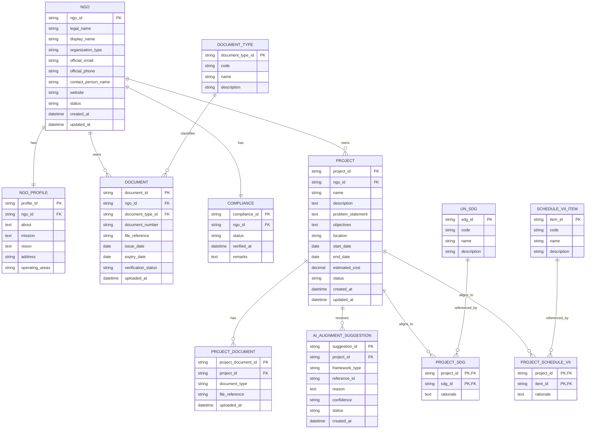

# NGO–CSR Bridging Platform — Phase 1 Digital Domain/ER Model

## Phase 1 scope

- NGO registration and organization information
- NGO profile create/update
- NGO government/supporting documents
- Document-level verification
- Overall compliance status
- Project create/update
- Project documents
- Estimated project cost / project cost report
- UN SDG alignment
- Schedule VII alignment
- AI suggestions for alignment
- NGO accepts/rejects AI suggestions

Excluded from Phase 1:
- Funding
- Payments
- Transactions
- Bank integration
- Fund utilization
- Expense tracking
- CSR–NGO matching
- Impact verification

## Digital ER diagram



## Core mental model

```text
NGO
├── Registration / Onboarding
├── Profile
├── Documents
│   └── Document Type
├── Compliance
└── Projects
    ├── Project Details
    ├── Project Documents
    ├── Estimated Cost / Cost Report
    ├── AI Alignment Suggestions
    └── Confirmed Alignment
        ├── UN SDG
        └── Schedule VII
```

## Important modeling decisions

### Registration
Registration is the onboarding process that creates the NGO. We are not keeping a separate registration table in the current Phase 1 ER model.

### Documents
Document Type is controlled/reference data. Example types:
- CSR-1
- FCRA
- PAN
- 12A / 12AB
- 80G
- 2-FY Reports
- Registration Certificate
- Other

`document_number`, `issue_date`, and `expiry_date` are optional because they do not apply to every document type.

### Compliance
`DOCUMENT.verification_status` answers:
> Has this individual document been reviewed?

`COMPLIANCE.status` answers:
> What is the NGO's overall compliance/verification status?

### Project cost
`PROJECT.estimated_cost` represents the expected cost of the project. It is not funding received.

### AI alignment
AI suggests possible UN SDGs and Schedule VII items. The NGO reviews the suggestions. Only accepted/confirmed selections become the project's actual alignment.
